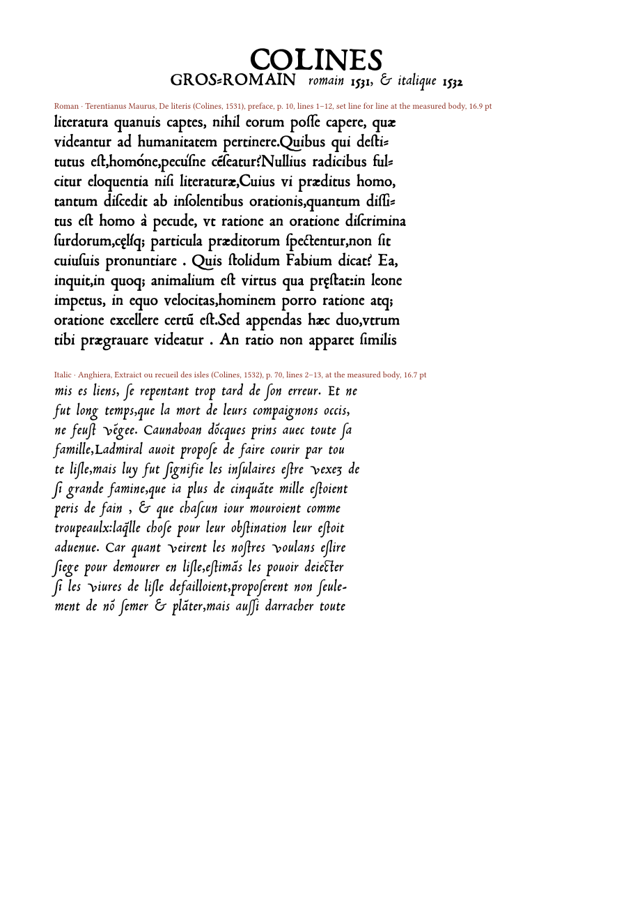

# Colines Gros-romain (1531–32)

Digital reconstructions of two types cut by Simon de Colines in Paris: his Great Primer
(*Gros-romain*) roman of 1531, the "Terentianus" roman, and the Great Primer chancery
italic of 1532, later copied by Garamont. They are built from impressions of the real
type on Colines's own pages, not redrawn.

## Two versions of each style

- **Colines Gros-romain** (`ColinesGros-romain-Roman.otf`, `-Italic.otf`): the shape of the
  type itself, estimated by registering and averaging every impression of each letter on
  the transcribed pages.
- **Colines Gros-romain Impression**: one real, typical impression of each sort, as it
  printed, with its ink spread and grain.

Regular is the 1531 roman and Italic the 1532 italic, so Ctrl+I switches between them.

## Sources

| Style | Book | Copy | Pages |
|---|---|---|---|
| Roman (Vervliet §14) | Terentianus Maurus, *De literis, syllabis, pedibus et metris* (Colines, 1531) | Bayerische Staatsbibliothek, MDZ bsb10198271 | 10 pages + 6 single-line blocks |
| Italic (Vervliet §24) | Anghiera, *Extraict ou recueil des isles nouvellement trouvees* (Colines, 1532) | John Carter Brown Library, Internet Archive | 15 pages + 21 single-line blocks |
| Both: Z, z, ⸗ and the roman figures; more impressions of the italic figures | Paulus Aegineta, *Opus de re medica* (Colines, 1532) | Bayerische Staatsbibliothek, MDZ bsb10139769 | 42 roman + 34 italic single-line blocks (text lines, folios, *Annotationes*) |

Each page was transcribed line by line, so every letter shape and every spacing value is
measured from labelled impressions: about 10,000 printed letter pairs per style.

## Faithful, not completed

Nothing is invented. A letter is in a font only when real impressions of that fount and
state exist; one seen only once or twice was checked by eye against its word on the page.
The roman's first state (1531–32) is kept apart from its 1533 recut capitals.

| | Glyphs | Fidelity: font vs print (print vs print) | Missing |
|---|---|---|---|
| Regular | 92 | **0.870** (0.835) | Y, ! ' |
| Italic | 77 | **0.841** (0.786) | K j k, ; ? ! ', œ |

Fidelity is the median overlap (IoU) between each letter of the font and its printed
impressions: the font is closer to the impressions than they are to each other. J, U, W
and w had not been cut in these founts. Every glyph, with its number of impressions, is
in the catalogue ([specimen/Colines_catalogue.pdf](specimen/Colines_catalogue.pdf)).

## Using the fonts

- The body is the measured line pitch: set the roman at **16.9 pt** and the italic at
  **16.7 pt** to match the books at actual size.
- Ligatures: ſt ſi ſſ ct fi fl and others, as each style had them (ct is a historical
  ligature, feature `hlig`). In Word: Font > Advanced > Ligatures: All.
- Long s: type ſ (U+017F), or turn on the `hist` feature.
- p̃ and q̃ (abbreviations): type p or q, then U+0303.

## Installing

Download the fonts from the **Releases** page: one zip of TrueType fonts, one of
OpenType, each with installation notes. Install **one** of the two sets, not both: they
share font names.

- **Microsoft Word and Office: use `fonts/ttf/`** (TrueType outlines). Word on Windows does
  not lay out OpenType fonts with CFF outlines correctly.
- **Everything else (InDesign, Affinity, LibreOffice, macOS, the web): `fonts/`**
  (OpenType, CFF outlines). These are the reference versions.

## Repository

- `fonts/`: the four OpenType (CFF) fonts; `fonts/ttf/`: the same with TrueType outlines.
- `specimen/`: a specimen sheet and the catalogue (every glyph, what each font lacks), with
  their Typst sources.
- `DOCUMENTATION.md`: aims, sources, the pipeline, rules and decisions, checks, fixes,
  and what each font contains.
- `EXTENDING.md`: how to rebuild, add a page or fill a missing letter.
- `scripts/`, `configs/`, `transcriptions/`: the complete pipeline (Python), the page
  blocks and the hand-checked transcriptions.
- The scans are not redistributed: `scripts/fetch_sources.py` downloads them from their
  holders and `scripts/prep_all.sh` cuts the exact blocks used.

## Credits

Scans: **Bayerische Staatsbibliothek** (Münchener DigitalisierungsZentrum) and the
**John Carter Brown Library** via the **Internet Archive**. The founts are identified and
measured after H. D. L. Vervliet, "Simon de Colines, punchcutter 1518–1546" (2003) and
*The Palaeotypography of the French Renaissance* (2008).

Made with the same pipeline as [Caslon 1734](https://github.com/nathanmsolomon/caslon-1734).

## Licence

Fonts: [SIL Open Font License 1.1](OFL.txt), Reserved Font Name "Colines Gros-romain".
Code and documentation: [MIT](LICENSE).
